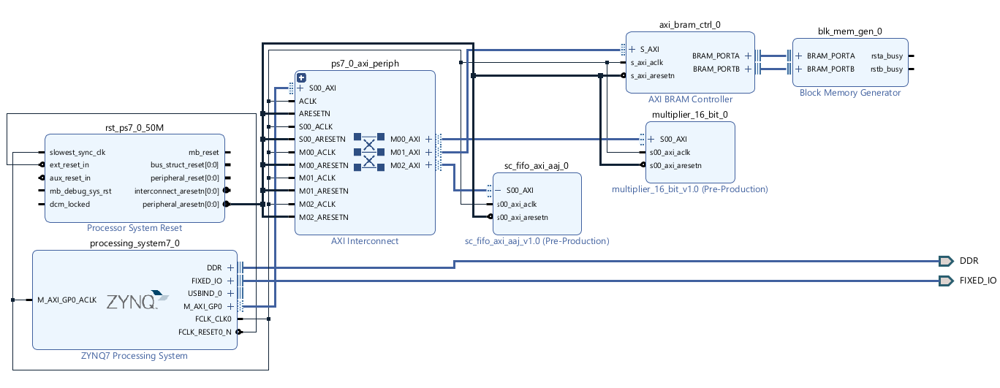
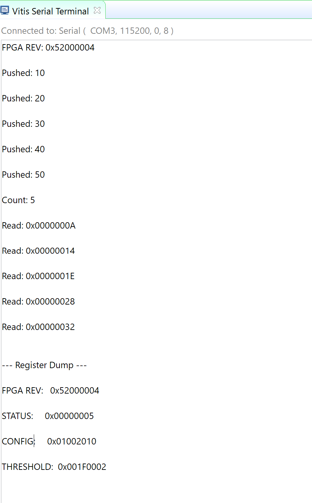

# Overview
Building on the 16-bit sc_fifo module form Lab 3, this lab packages it as a custom AXI-4Lite peripheral (sc_fifo_axi_aaj) and integrates it into a Zynq SoC system to veify operation via C software running on the ARM PS.

# Design Summary
### System Architecture
The design integrates a custom AXI4-Lite peripheral into a Zynq PS+PL system.
The ARM Cortex-A9 processor communicates with the FIFO IP over the AXI4-Lite 
bus through the AXI Interconnect block.

### Custom IP: sc_fifo_axi_aaj
The IP wraps the Lab 3 sc_fifo module with an AXI4-Lite slave interface. 
The register map exposes 9 registers at base address 0x43C10000:

| Offset | Register      | Access |
|--------|---------------|--------|
| 0x00   | FPGA_REV      | RO     |
| 0x04   | FIFO_RST      | WO     |
| 0x08   | WR_DATA       | WO     |
| 0x0C   | RD_REQ        | WO     |
| 0x10   | RD_DATA       | RO     |
| 0x14   | STATUS        | RO     |
| 0x18   | DATA_COUNT    | RO     |
| 0x1C   | CONFIG        | RO     |
| 0x20   | THRESHOLD     | RO     |

# Verificaiton and Results

# Known Issues or Limitations
During Vitis BSP configuration, only the multiplier_16_bit driver was set to 
"none" while sc_fifo_axi_aaj was left at default, causing multiple build errors. 
Setting both IP drivers to "none" resolved the issue.

# References
ece520L_fall26_lab4_custom_axi_lite_ip.pdf
